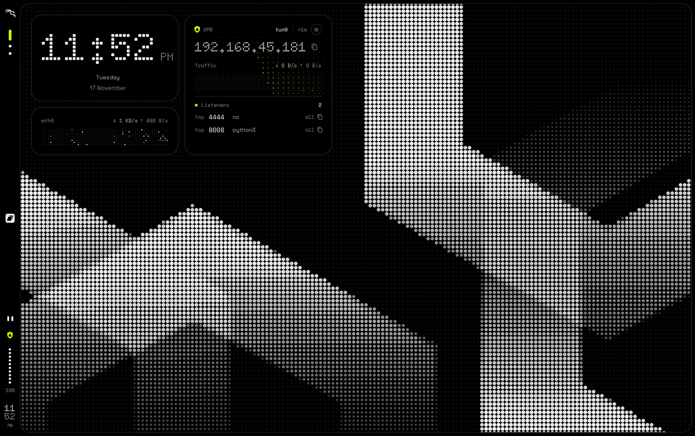
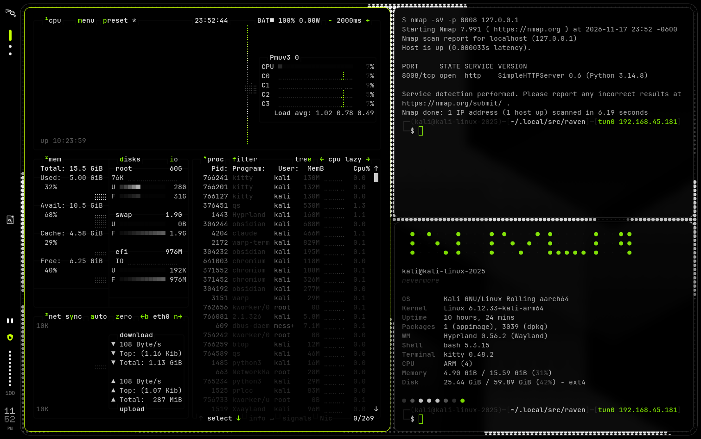
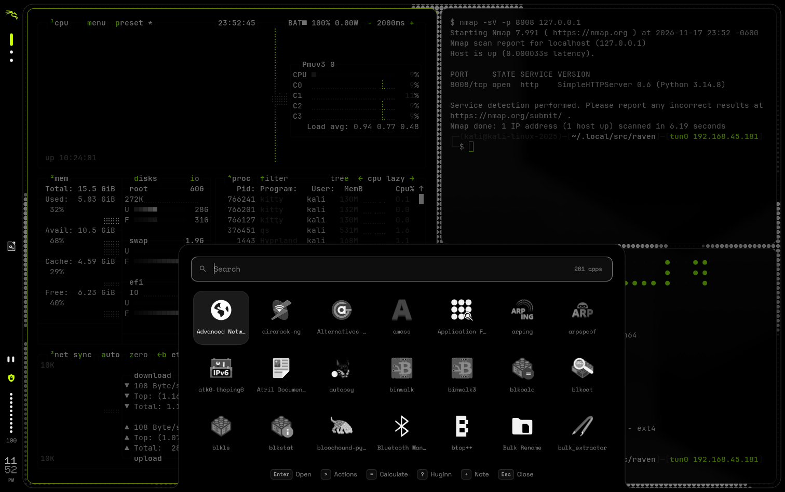
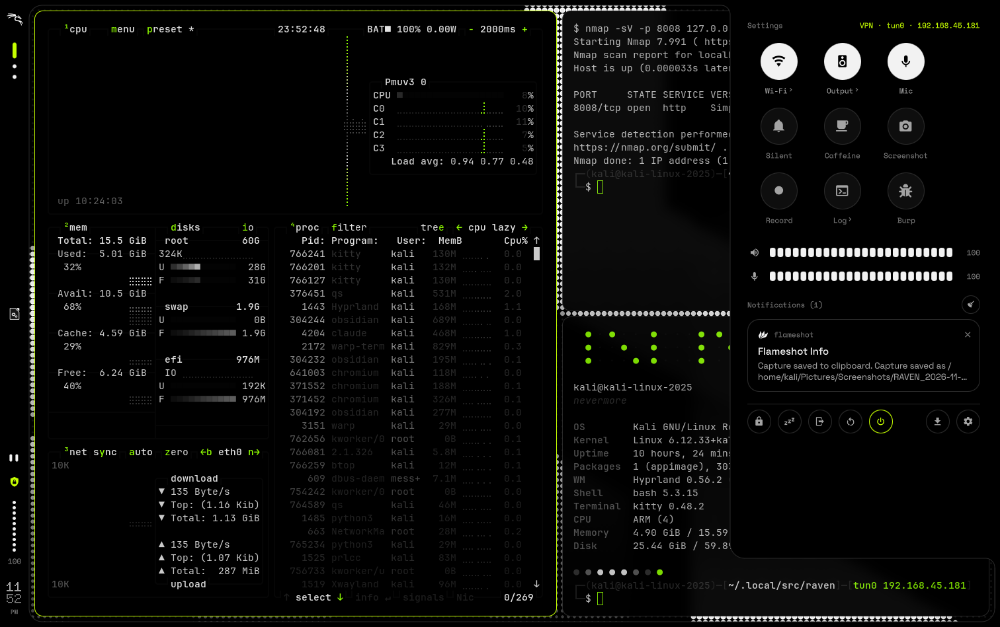
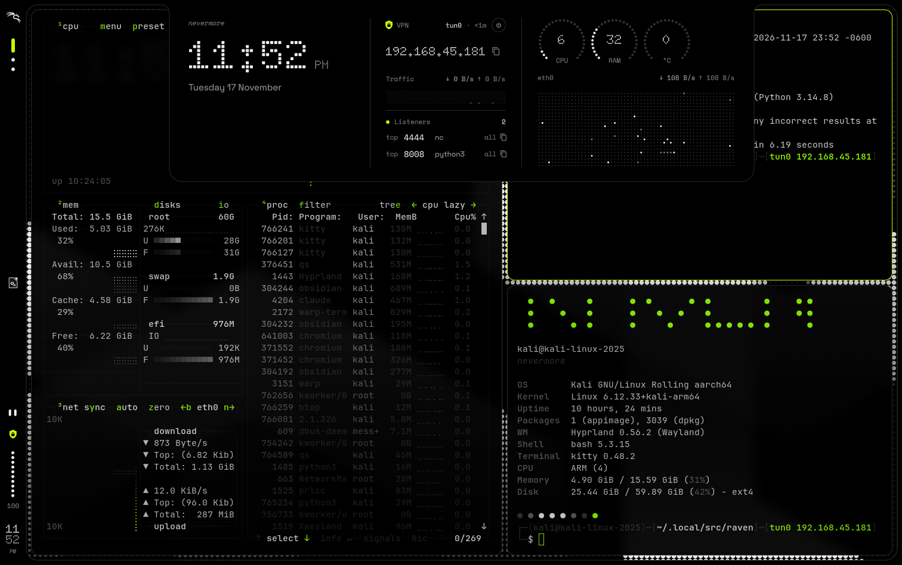
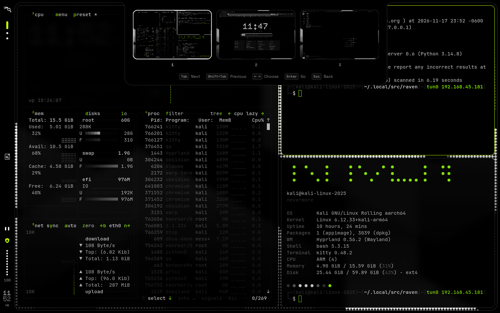
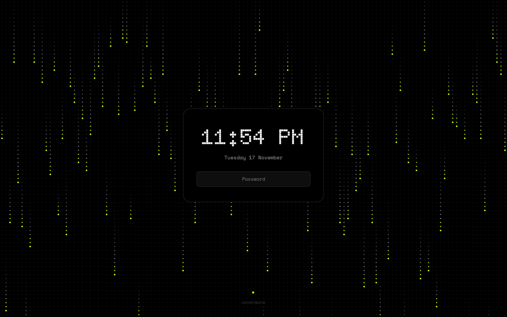

# RAVEN

A Hyprland desktop for Kali Linux: black, grey, and `#C6FF00`.

The desktop shell is a remix of [NIHIL](https://github.com/poligle/Nihil-Shell) by poligle (MIT), a
Quickshell shell written for NixOS, ported to Kali with some added hacker flavour. This repo holds
everything layered on top: the port itself (`gen.py`), configs, themes and helper scripts.



| | |
|---|---|
|  |  |
| Terminals: btop, nmap, fastfetch (the prompt shows the tun0 IP) | Launcher (`⌘Space`): apps, actions, calculator, notes |
|  |  |
| Quick settings: toggles, engagement log, Burp proxy | Dashboard: clock, VPN, system |
|  |  |
| Workspace switcher (`⌘Tab`) | Lock screen: staggered dot rain |

## Install

```bash
./install.sh --packages     # apt packages (sudo), then everything else
./install.sh                # everything else, if the packages are already there
./install.sh --dry-run      # show what would change, change nothing
./install.sh --login        # also theme the LightDM login screen (sudo)
```

Then log in with the **Hyprland (uwsm-managed)** session (plain Hyprland can start before logind hands it the seat in a VM, leaving no input). The installer is safe to re-run: identical files
are skipped, different ones are backed up to `~/.local/state/raven/backups/<time>/` before
being replaced, and nothing is deleted. Shade of Z - White icons are picked up from
`~/Icons/Shade of Z - White` if present (they are not part of this repo).

## What's in it

| Path | What |
|---|---|
| `gen.py`, `build.sh`, `tokens.json` | Builds `~/.config/quickshell/raven` from the pinned NIHIL checkout: rebrand, accent, patches, Config/Lang/Tokens |
| `qml/` | RAVEN's own shell pieces: VPN + listeners cards, quick notes, the Shortcuts page |
| `hypr/` | Hyprland (Lua), hyprlock, hypridle, hyprpaper |
| `bin/` | `raven-*` helpers: wallpaper, screenshots, clipboard, listeners, notes, header... |
| `shell/prompt.bash` | Terminal prompt (tun0 IP, exit codes) and session header |
| `gtk/`, `apply-theme.sh` | GTK/Qt colours, RAVEN icon theme (grey Papirus folders + custom icons), cursor |
| `firefox/`, `vscode/`, `warp/`, `kitty/`, `btop/`, `fastfetch/`, `flameshot/` | App themes |
| `login/` | LightDM login screen (sudo installer) |
| `apps/`, `xfce/`, `icons/` | Launcher entries, Warp as the default terminal, the Warp icon |
| `wallpapers/` | Extra wallpapers (rendered as dot matrices with NIHIL's renderer) |

## Keys

Live list in **Preferences → Shortcuts** (`⌘O`), read from Hyprland. Highlights (Mac keyboard
in Parallels with "send macOS shortcuts" on; ⌘ = Super, ⌥ = Alt):

| Keys | What |
|---|---|
| `⌘Space` | Launcher (`?` asks Huginn, `+` adds a quick note, `=` calculates) |
| `⌘Tab` | Workspace switcher: hold ⌘, tap Tab, release |
| `⌘.` · `⌘D` · `⌘H` · `⌘W` | Quick settings · dashboard · clipboard history · wallpapers |
| `⌘Return` · `⌘B` · `⌘⌥B` · `⌘E` | Warp · Firefox · Chromium · files |
| `⌘⌥O` · `⌘⌥N` | Obsidian drop-down · quick note into today's daily note |
| `⌘⌥S` · `⌘⌥A` | Scratchpad: show / hide · park a window |
| `⌘1`…`⌘0` · `⌘⌥1`…`⌘⌥0` | Go to workspace · send the window there |
| `⌘[` `⌘]` `⌘\` · `⌘⌥F` | Snap left / right / fill · maximize |
| `⌘⇧S` · `⌘⇧R` | Screenshot an area · record an area |
| `⌘K` | Lock |

## Credits

NIHIL by Pol Iglesias (MIT, see the upstream LICENSE, shipped with the built shell) ·
adw-gtk3 · Papirus · Shade of Z by Seth Storm Rosenaa · Bibata cursors · Doto, Space
Grotesk, Space Mono (SIL OFL) · JetBrains Mono Nerd Font.

## License

MIT, see [LICENSE](LICENSE). NIHIL and the other projects above keep their own licenses.
